# babylon.quarks standalone

[](https://www.npmjs.com/package/babylon.quarks)
[](https://www.npmjs.com/package/babylon.quarks)
[](https://github.com/Soullnik/babylon.quarks-standalone/actions/workflows/ci.yml)
[](LICENSE)
[](https://www.typescriptlang.org/)

**A high-performance, GPU-batched particle system and VFX library for [Babylon.js](https://www.babylonjs.com/)** — trails, mesh particles, sub-emitters and 20+ behaviors, a Shuriken-style visual effect editor, WebGL & WebGPU rendering, and a Unity → Quarks exporter.

**[Live demos](https://soullnik.github.io/babylon.quarks-standalone/)** · **[Effect editor](https://soullnik.github.io/babylon.quarks-standalone/editor.html)** · **[API docs](https://soullnik.github.io/babylon.quarks-standalone/docs/)** · **[npm](https://www.npmjs.com/package/babylon.quarks)**

This monorepo holds the `babylon.quarks` npm package, an in-house visual effect editor, a Unity exporter, and Babylon.js examples. The engine (`quarks.core`) is historically derived from [quarks.art](https://quarks.art/) / three.quarks.

## Features

- **GPU-batched rendering** — one draw call across many systems for high particle counts, with adaptive performance scaling
- **Full behavior stack** — color / size / rotation over life, noise, turbulence, forces, collision, velocity, by-speed modifiers, and sub-emitters
- **Trails, beams, stretched billboards & mesh particles** — plus emission from mesh surfaces, and smoothed trails with curve tension
- **Texture effects** — per-texture UV layout (channel, tiling, offset, scroll), gradient maps, alpha erosion, UV distortion, flip, soft particles, rim lighting on meshes
- **Scene integration** — render order, layer masks, fog, culling modes, sort modes, screen-size limits and an `EffectPool` for one-shot effects
- **Shuriken-style visual editor** — module inspector, curves, gradients and a timeline; export / import Quarks JSON
- **WebGL & WebGPU** · **TypeScript-first** · **Unity → Quarks exporter**

## npm package

- Package: [`babylon.quarks`](https://www.npmjs.com/package/babylon.quarks)
- Install:

```bash
npm install babylon.quarks @babylonjs/core
```

## Get started

Requires an existing Babylon.js `Scene`. Peer dependency: `@babylonjs/core` >= 9.

```ts
import {
    BatchedRenderer,
    ParticleSystem,
    PointEmitter,
    RenderMode,
    ConstantValue,
    IntervalValue,
    ConstantColor,
} from 'babylon.quarks';
import {Color4} from '@babylonjs/core/Maths/math.color';

// One renderer per scene; it batches every system added to it into shared draw calls.
const batchRenderer = new BatchedRenderer('particles', scene);

const system = new ParticleSystem({
    scene,
    duration: 5,
    looping: true,
    startLife: new IntervalValue(4, 5),
    startSpeed: new ConstantValue(1),
    startSize: new IntervalValue(1, 2),
    startColor: new ConstantColor(new Color4(1, 1, 1, 1)),
    emissionOverTime: new ConstantValue(20),
    shape: new PointEmitter(),
    renderMode: RenderMode.BillBoard,
    texture: myParticleTexture,
    transparent: true,
});
batchRenderer.addSystem(system);

// Advance the simulation every frame:
scene.onBeforeRenderObservable.add(() => {
    batchRenderer.update(scene.getEngine().getDeltaTime() / 1000);
});
```

### Load an authored effect

Effects designed in the [effect editor](https://soullnik.github.io/babylon.quarks-standalone/editor.html) or [Unity exporter](tools/unity-quarks-exporter/README.md) (or exported from [quarks.art](https://quarks.art/) — same JSON format) load with `QuarksLoader` instead of being hand-coded:

```ts
import {BatchedRenderer, QuarksLoader, QuarksUtil} from 'babylon.quarks';

const batchRenderer = new BatchedRenderer('particles', scene);
const loader = new QuarksLoader(scene);
const effect = await loader.load('effects/explosion.json');
QuarksUtil.addToBatchRenderer(effect, batchRenderer);
QuarksUtil.play(effect);

scene.onBeforeRenderObservable.add(() => {
    batchRenderer.update(scene.getEngine().getDeltaTime() / 1000);
});
```

Disabling an emitter (`system.emitter.visible = false`, or `setEnabled(false)` on the node) freezes that system: it is neither drawn nor simulated, and it picks up where it left off when re-enabled. This matches Unity's behaviour for a disabled Particle System, and makes parked effects in a VFX pool free.

For the Babylon.js Playground or plain `<script>` usage there is a UMD bundle exposed as the `BabylonQuarks` global — see the [package README](packages/babylon.quarks/README.md#use-in-the-babylonjs-playground) for a paste-ready Playground snippet:

```js
await BABYLON.Tools.LoadScriptAsync('https://cdn.jsdelivr.net/npm/babylon.quarks/dist/babylon.quarks.umd.min.js');
const {BatchedRenderer, ParticleSystem} = BabylonQuarks;
```

Full API reference, WebGPU setup and more: [package README](packages/babylon.quarks/README.md) · [API docs](https://soullnik.github.io/babylon.quarks-standalone/docs/).

## Author effects

- **[Effect editor](https://soullnik.github.io/babylon.quarks-standalone/editor.html)** — our own Shuriken-style visual editor (hierarchy panel + module inspector). Try it live, or run it locally with `npm run examples` and open `editor.html`. See the [`babylon.quarks-editor` README](packages/babylon.quarks-editor/README.md) to embed it in your own app.
- **[Unity exporter](tools/unity-quarks-exporter/README.md)** — author in Unity's Shuriken Particle System and export straight to Quarks JSON via a Unity Editor tool (`.unitypackage`, UPM, or copy-in).
- Effects exported from the [quarks.art](https://quarks.art/) editor still load fine — it's the same JSON format, read by `QuarksLoader` regardless of which tool produced it.

## Live examples

[GitHub Pages demo](https://soullnik.github.io/babylon.quarks-standalone/) · [API docs](https://soullnik.github.io/babylon.quarks-standalone/docs/) · [Particle benchmark](https://soullnik.github.io/babylon.quarks-standalone/benchmark.html) (babylon.quarks vs Babylon's built-in CPU/GPU particle systems)

|                                                                                                                                                                                                                                                                                               |                                                                                                                                                                                                                                                                                         |                                                                                                                                                                                                                                                                                               |                                                                                                                                                                                                                                                                                                              |
| --------------------------------------------------------------------------------------------------------------------------------------------------------------------------------------------------------------------------------------------------------------------------------------------- | --------------------------------------------------------------------------------------------------------------------------------------------------------------------------------------------------------------------------------------------------------------------------------------- | --------------------------------------------------------------------------------------------------------------------------------------------------------------------------------------------------------------------------------------------------------------------------------------------- | ------------------------------------------------------------------------------------------------------------------------------------------------------------------------------------------------------------------------------------------------------------------------------------------------------------ |
| [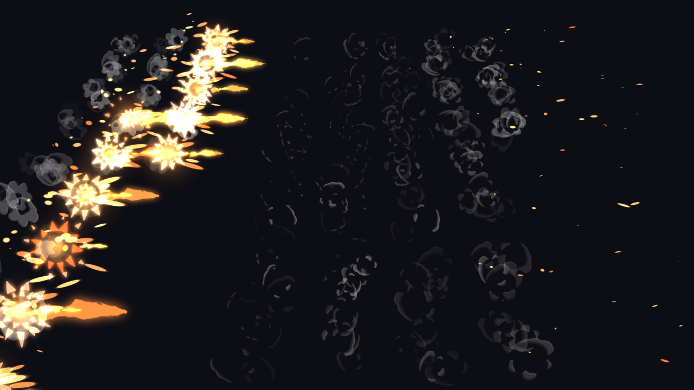](https://soullnik.github.io/babylon.quarks-standalone/babylonDemo.html#MuzzleFlashDemo)<br>[Muzzle Flash](https://soullnik.github.io/babylon.quarks-standalone/babylonDemo.html#MuzzleFlashDemo)                                  | [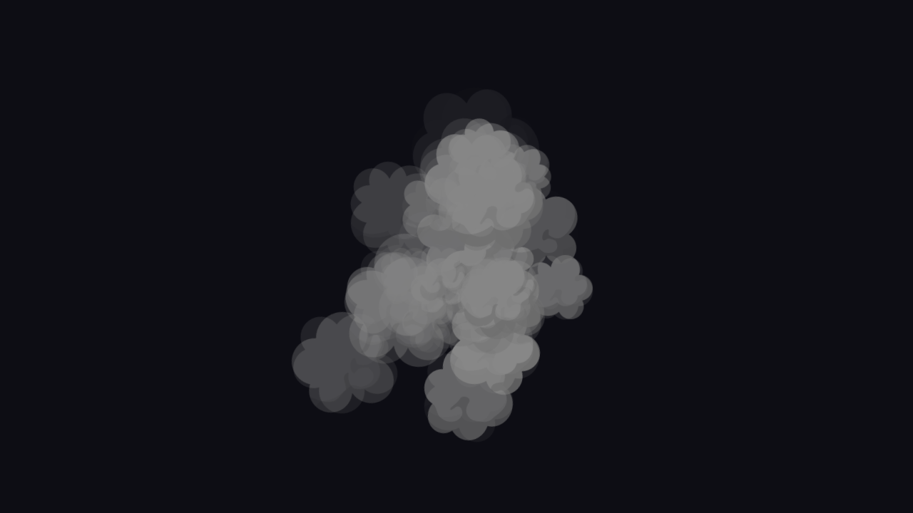](https://soullnik.github.io/babylon.quarks-standalone/babylonDemo.html#ExplosionDemo)<br>[Explosion (Unity export)](https://soullnik.github.io/babylon.quarks-standalone/babylonDemo.html#ExplosionDemo)           | [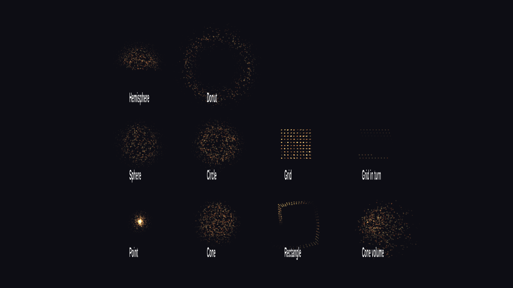](https://soullnik.github.io/babylon.quarks-standalone/babylonDemo.html#EmitterShapeDemo)<br>[Emitter Shapes](https://soullnik.github.io/babylon.quarks-standalone/babylonDemo.html#EmitterShapeDemo)                           | [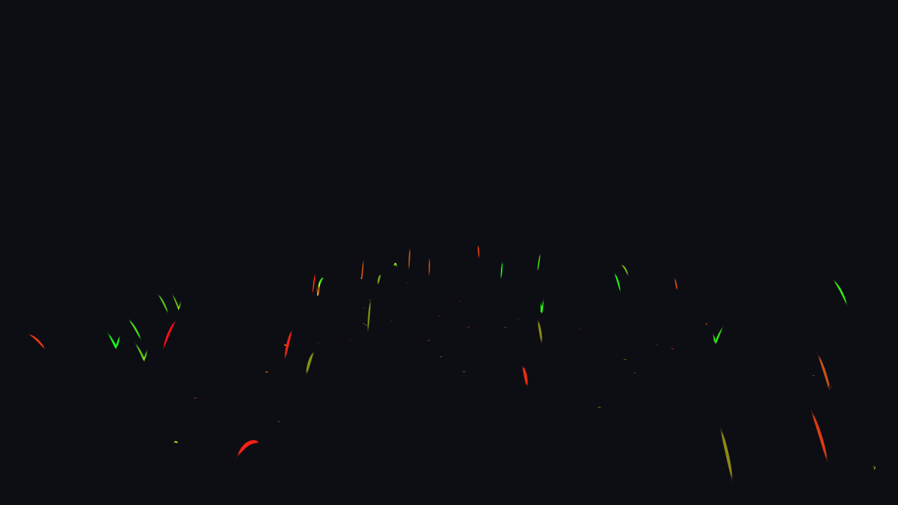](https://soullnik.github.io/babylon.quarks-standalone/babylonDemo.html#TrailDemo)<br>[Trail Renderer](https://soullnik.github.io/babylon.quarks-standalone/babylonDemo.html#TrailDemo)                                                                |
| [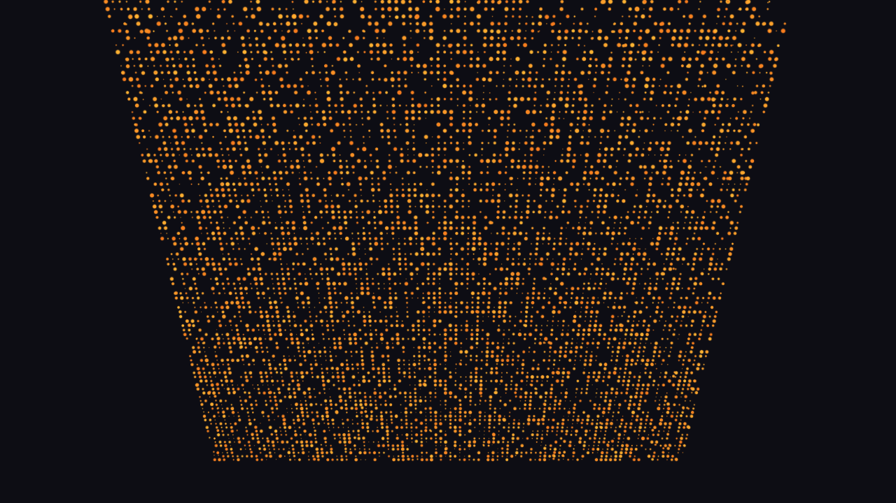](https://soullnik.github.io/babylon.quarks-standalone/babylonDemo.html#SequencerDemo)<br>[Texture Sequencer](https://soullnik.github.io/babylon.quarks-standalone/babylonDemo.html#SequencerDemo)                               | [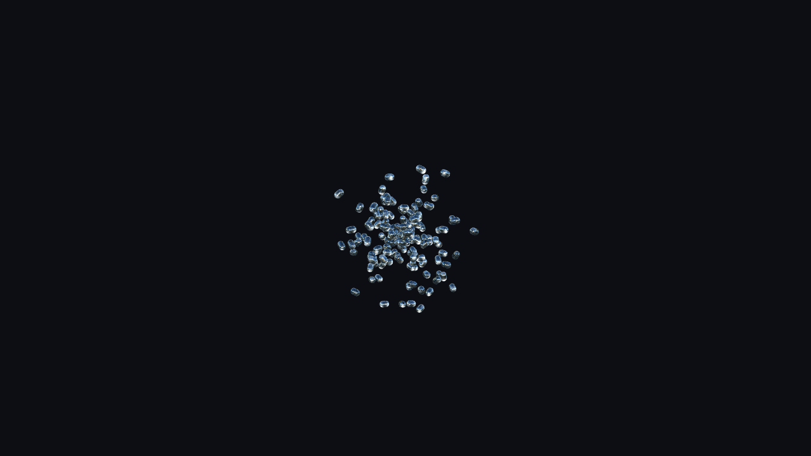](https://soullnik.github.io/babylon.quarks-standalone/babylonDemo.html#MeshMaterialDemo)<br>[Mesh Material](https://soullnik.github.io/babylon.quarks-standalone/babylonDemo.html#MeshMaterialDemo)                       | [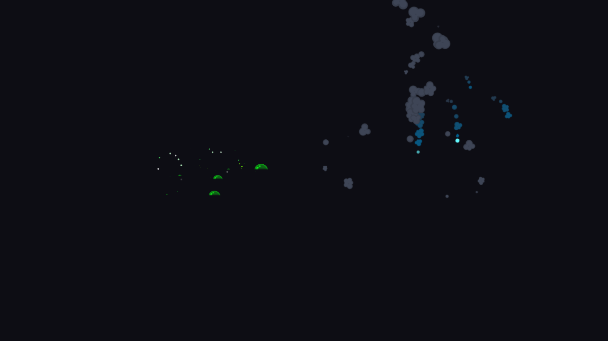](https://soullnik.github.io/babylon.quarks-standalone/babylonDemo.html#SubEmitterDemo)<br>[Sub Emitter](https://soullnik.github.io/babylon.quarks-standalone/babylonDemo.html#SubEmitterDemo)                                       | [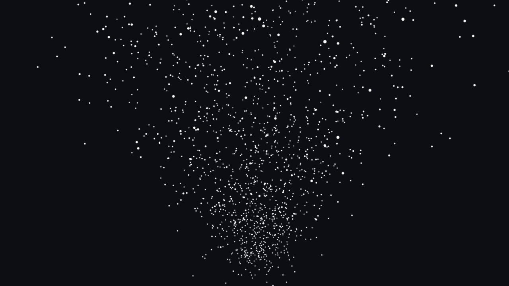](https://soullnik.github.io/babylon.quarks-standalone/babylonDemo.html#TurbulenceDemo)<br>[Noise Turbulence](https://soullnik.github.io/babylon.quarks-standalone/babylonDemo.html#TurbulenceDemo)                                             |
| [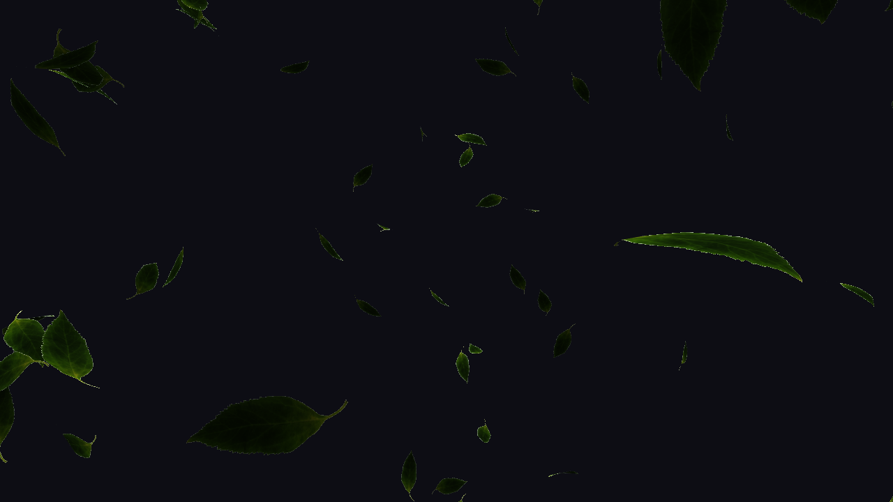](https://soullnik.github.io/babylon.quarks-standalone/babylonDemo.html#AlphaTestDemo)<br>[Alpha Test Mesh](https://soullnik.github.io/babylon.quarks-standalone/babylonDemo.html#AlphaTestDemo)                                  | [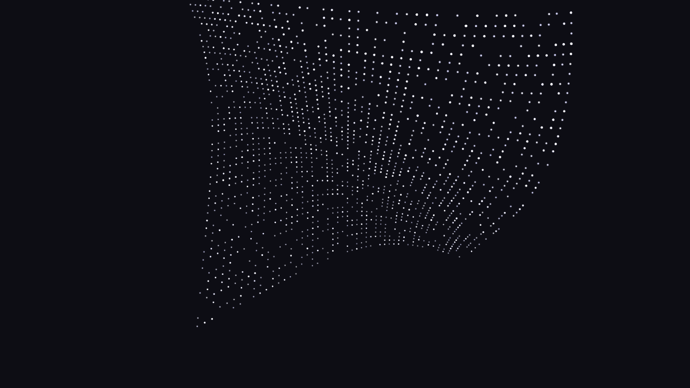](https://soullnik.github.io/babylon.quarks-standalone/babylonDemo.html#CustomPluginDemo)<br>[Customized Plugin](https://soullnik.github.io/babylon.quarks-standalone/babylonDemo.html#CustomPluginDemo)               | [](https://soullnik.github.io/babylon.quarks-standalone/babylonDemo.html#BillboardDemo)<br>[Billboard Modes](https://soullnik.github.io/babylon.quarks-standalone/babylonDemo.html#BillboardDemo)                                   | [](https://soullnik.github.io/babylon.quarks-standalone/babylonDemo.html#SoftParticleDemo)<br>[Soft Particles and Blend Tiles](https://soullnik.github.io/babylon.quarks-standalone/babylonDemo.html#SoftParticleDemo)          |
| [](https://soullnik.github.io/babylon.quarks-standalone/babylonDemo.html#CustomBlendingDemo)<br>[Custom Blending Function](https://soullnik.github.io/babylon.quarks-standalone/babylonDemo.html#CustomBlendingDemo) | [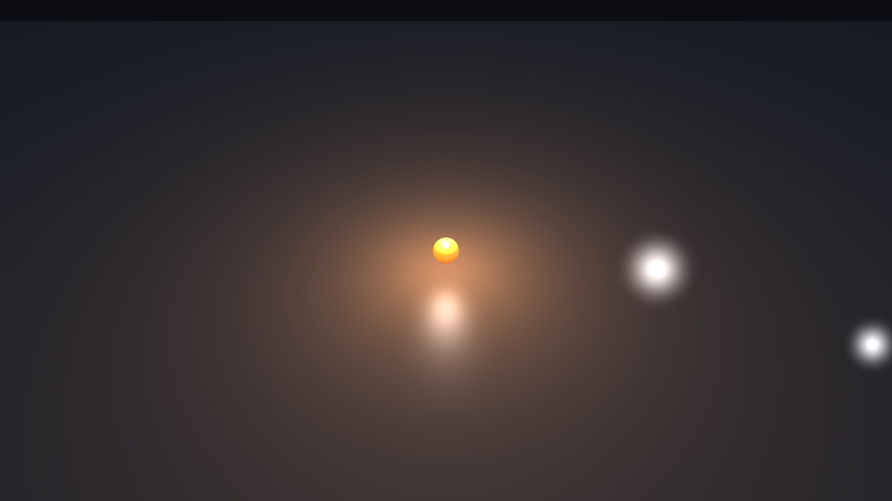](https://soullnik.github.io/babylon.quarks-standalone/babylonDemo.html#FollowObjectDemo)<br>[Following Moving Objects](https://soullnik.github.io/babylon.quarks-standalone/babylonDemo.html#FollowObjectDemo) | [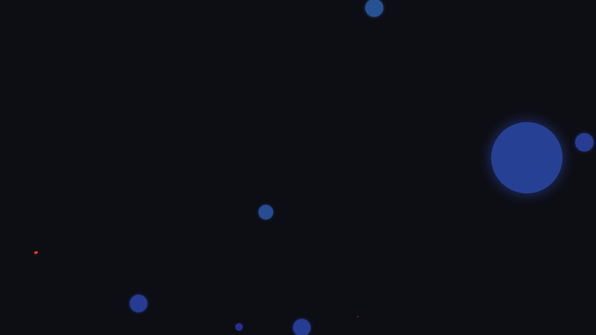](https://soullnik.github.io/babylon.quarks-standalone/babylonDemo.html#PickUpDemo)<br>[Pick-Up Burst](https://soullnik.github.io/babylon.quarks-standalone/babylonDemo.html#PickUpDemo)                                               | [](https://soullnik.github.io/babylon.quarks-standalone/babylonDemo.html#LevelUpDemo)<br>[Level-Up](https://soullnik.github.io/babylon.quarks-standalone/babylonDemo.html#LevelUpDemo)                                                                     |
| [](https://soullnik.github.io/babylon.quarks-standalone/babylonDemo.html#ElectricBallDemo)<br>[Electric Ball](https://soullnik.github.io/babylon.quarks-standalone/babylonDemo.html#ElectricBallDemo)                             | [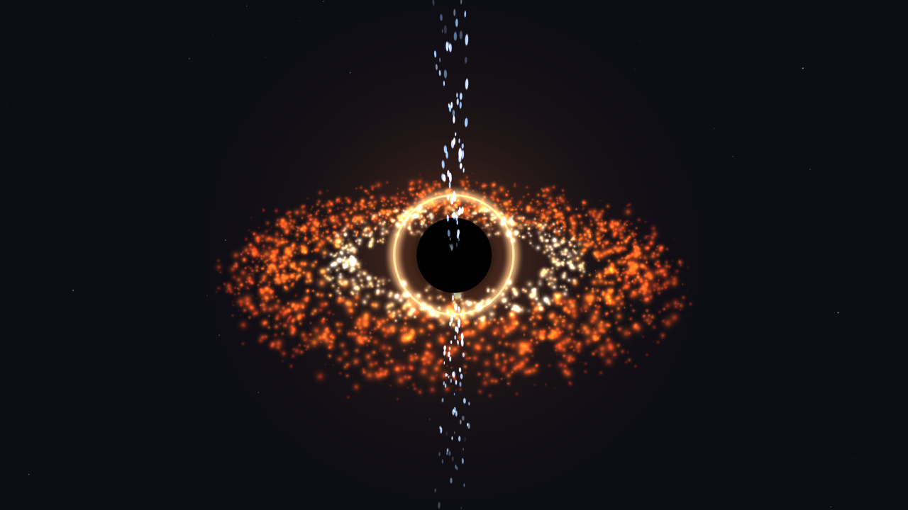](https://soullnik.github.io/babylon.quarks-standalone/babylonDemo.html#BlackHoleDemo)<br>[Black Hole](https://soullnik.github.io/babylon.quarks-standalone/babylonDemo.html#BlackHoleDemo)                                      | [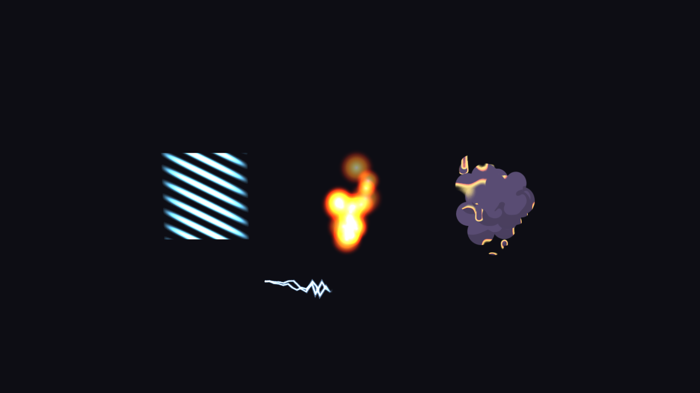](https://soullnik.github.io/babylon.quarks-standalone/babylonDemo.html#TextureEffectsDemo)<br>[Texture Effects](https://soullnik.github.io/babylon.quarks-standalone/babylonDemo.html#TextureEffectsDemo)                   | [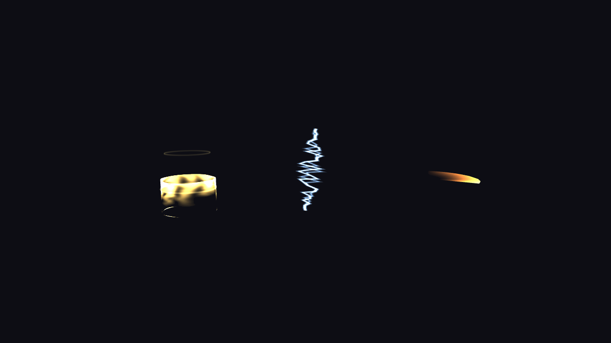](https://soullnik.github.io/babylon.quarks-standalone/babylonDemo.html#AuraTrailDemo)<br>[Aura, Strike & Weapon Trail](https://soullnik.github.io/babylon.quarks-standalone/babylonDemo.html#AuraTrailDemo)                         |
| [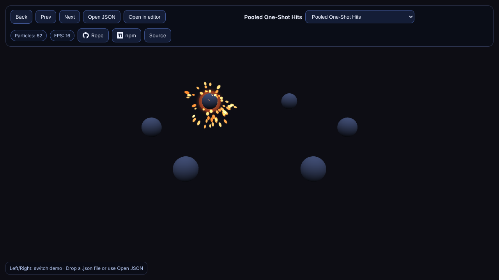](https://soullnik.github.io/babylon.quarks-standalone/babylonDemo.html#PooledHitsDemo)<br>[Pooled One-Shot Hits](https://soullnik.github.io/babylon.quarks-standalone/babylonDemo.html#PooledHitsDemo)                     | [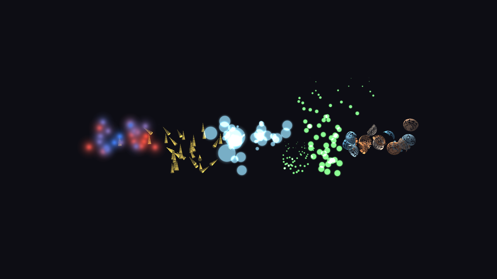](https://soullnik.github.io/babylon.quarks-standalone/babylonDemo.html#RendererOptionsDemo)<br>[Renderer Options](https://soullnik.github.io/babylon.quarks-standalone/babylonDemo.html#RendererOptionsDemo)        | [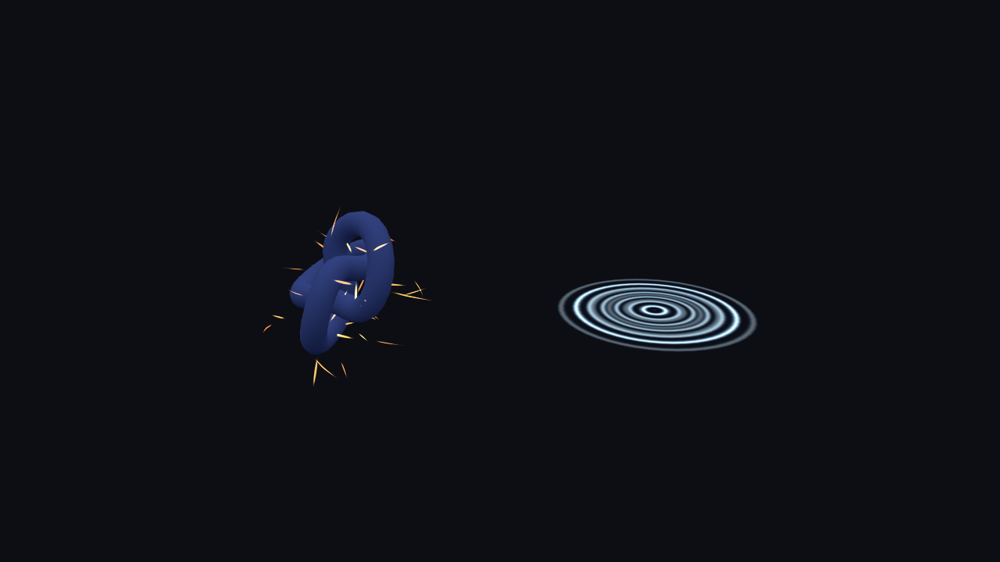](https://soullnik.github.io/babylon.quarks-standalone/babylonDemo.html#TrailSurfaceDemo)<br>[Surface Trails and Mesh UV2](https://soullnik.github.io/babylon.quarks-standalone/babylonDemo.html#TrailSurfaceDemo) | [](https://soullnik.github.io/babylon.quarks-standalone/babylonDemo.html#MagicZoneUnityExample)<br>[MagicZone (Unity export)](https://soullnik.github.io/babylon.quarks-standalone/babylonDemo.html#MagicZoneUnityExample) |

## Performance

The simulation runs on a column store with compiled behavior passes, and every system of a
scene is drawn through a few batched instanced draws. Measured against Babylon's built-in CPU
`ParticleSystem` on the same scenario (cone emitters, additive billboards, colour over life;
`renderer.update` + `scene.render` per frame on a `NullEngine`, so CPU time only, on a
GitHub-Actions-class VM):

| Particles | Emitters | babylon.quarks | Babylon `ParticleSystem` | Ratio |
| --------: | -------: | -------------: | -----------------------: | ----: |
|    10 000 |        1 |         0.9 ms |                   3.7 ms |  3.9× |
|    10 000 |       16 |         0.9 ms |                   5.0 ms |  5.5× |
|    50 000 |        1 |         4.1 ms |                  25.1 ms |  6.1× |
|    50 000 |       16 |         4.2 ms |                  25.3 ms |  6.1× |
|   100 000 |        1 |         9.0 ms |                  47.6 ms |  5.3× |
|   100 000 |       16 |         9.0 ms |                  58.3 ms |  6.5× |

The [benchmark page](https://soullnik.github.io/babylon.quarks-standalone/benchmark.html) runs
the same scenario in your browser, GPU included, against both the CPU and the GPU built-in
systems. Systems no camera sees can pause themselves (`cullingMode`), and `EffectPool` keeps
copies of a one-shot effect ready so playing one allocates nothing.

## Roadmap

See [ROADMAP.md](ROADMAP.md) for what is next (WebGPU on real hardware, the editor's remaining
items, GPU simulation) and how the library is positioned.

## Workspace structure

- `packages/babylon.quarks` - publishable package
- `packages/babylon.quarks-editor` - in-house Shuriken-style effect editor (headless core + React UI)
- `packages/quarks.core` - underlying particle simulation engine
- `tools/unity-quarks-exporter` - Unity Editor tool that exports Shuriken effects to Quarks JSON
- `examples` - Vite app used for local demos, the effect editor page and GitHub Pages

## Quick start

```bash
npm install
npm run build
npm run examples
```

Open local examples at `http://localhost:3010` (the effect editor is at `/editor.html`).

## Quality checks

```bash
npm run test
npm run build:examples
npm run check:pack
npm run check
```

## Refresh demo previews

Run the local examples server first, then generate screenshots:

```bash
npm run dev
npm run capture:previews
```

## Customize Texture Sequencer demo

`Texture Sequencer` reads two images:

- text shape: `examples/public/textures/text_texture.png`
- logo shape: `examples/public/textures/logo_texture.png`

Replace these files with your own PNG images to customize the demo output.

## Contributing

See [CONTRIBUTING.md](CONTRIBUTING.md) for the dev setup, quality checks, demo guide and PR conventions. Package changes are tracked in the [`babylon.quarks` changelog](packages/babylon.quarks/CHANGELOG.md) and the [`babylon.quarks-editor` changelog](packages/babylon.quarks-editor/CHANGELOG.md).

## Release checklist

1. Run `npm run check` from repository root.
2. Update the changed package(s)' `CHANGELOG.md` and bump their `package.json` version (`packages/babylon.quarks` and/or `packages/babylon.quarks-editor`).
3. Verify tarball content with `npm run check:pack` (covers both publishable packages).
4. Publish a GitHub release — CI publishes both `babylon.quarks` and `babylon.quarks-editor` to npm via trusted publishing (or run the `Publish npm package` workflow manually).
