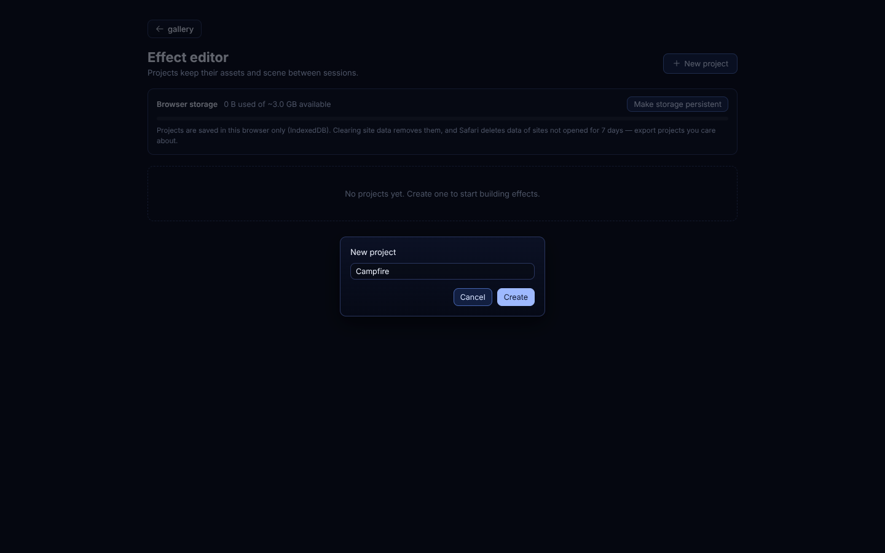
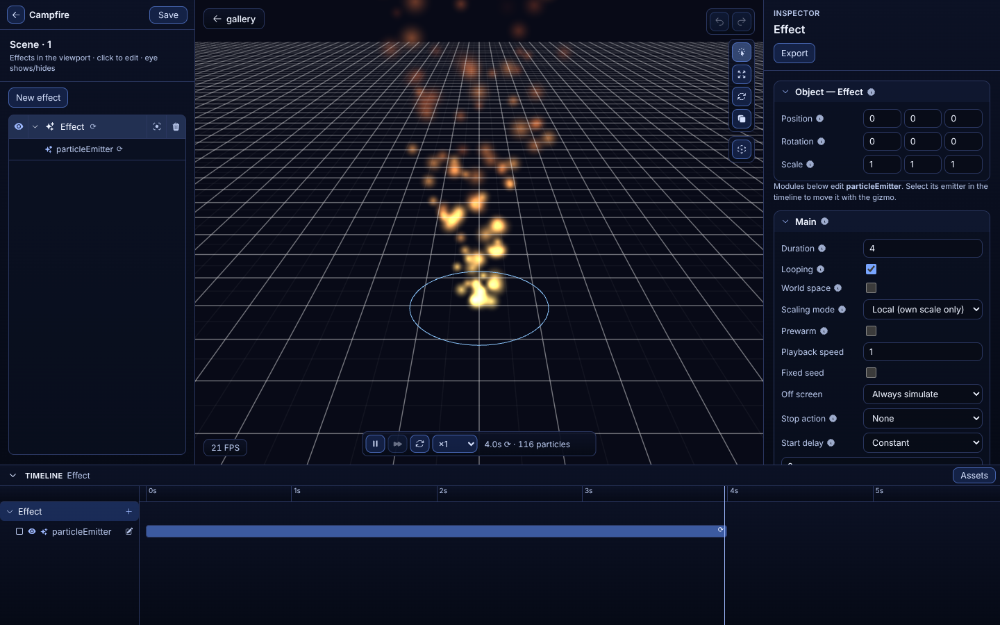
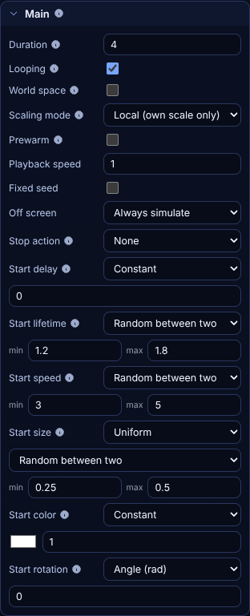
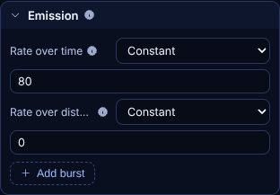
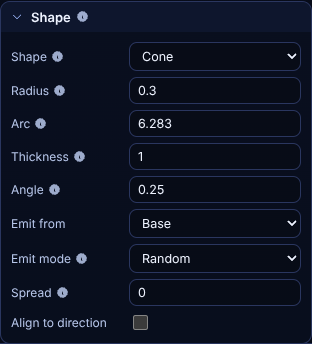
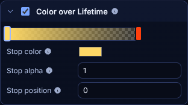
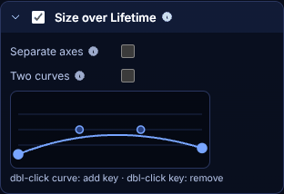
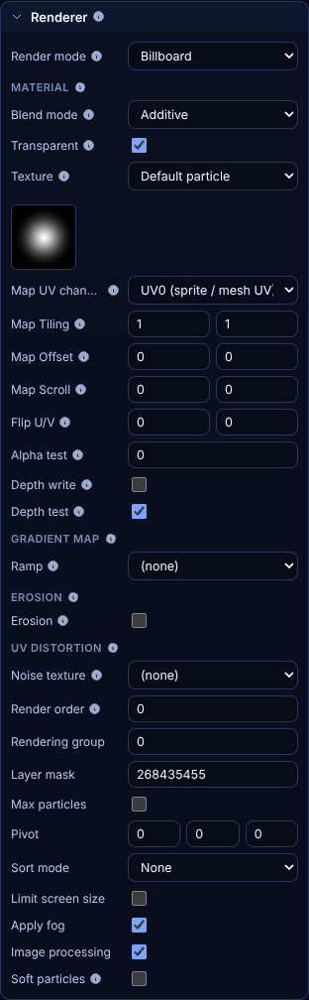
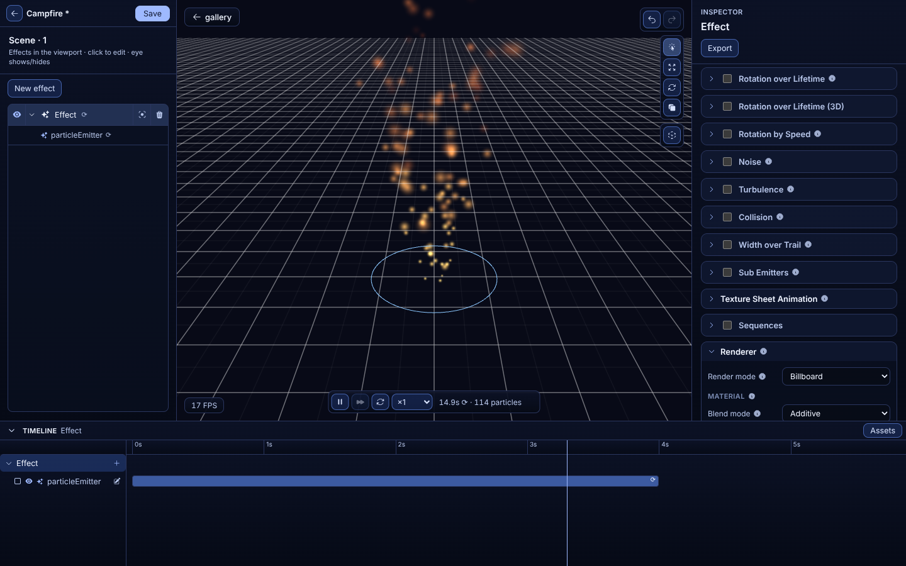

# Authoring an effect

This guide builds an effect in the [effect editor](https://soullnik.github.io/babylon.quarks-standalone/editor.html)
and plays it in your own Babylon.js app. It takes about ten minutes. The editor's modules follow
Unity's Particle System (Shuriken), so if you have built effects there, the names will be familiar;
[SHURIKEN_PARITY.md](SHURIKEN_PARITY.md) lists what matches and what is left.

The screenshots come from `npm run capture:guide`, so they show the editor as it is in this
repository.

## 1. Create a project

Open the editor and click **New project**. Name it and click **Create**.



A project keeps its effects, textures and meshes in your browser (IndexedDB) between sessions,
once you click **Save** at the top left (Ctrl+S); the editor asks before you leave with unsaved
changes. It is not uploaded anywhere: clearing the site's data removes it, and Safari removes data
of sites you have not opened for seven days. Export the effects you want to keep (step 9).

## 2. Find your way around



- **Left, the hierarchy.** The project's effects and, under each, its particle systems. The eye
  shows or hides one; **New effect** adds another. An effect can hold several systems, such as
  flames, sparks and smoke, which play together and load as one file.
- **Centre, the viewport.** The effect plays here. Drag to orbit, scroll to zoom. The buttons on
  the right pick the gizmo that moves, rotates or scales the effect, and show or hide the emitter
  shapes. Along its bottom edge: play and pause (Space), step one frame, restart, playback speed,
  the time and the live particle count. Undo and redo are at the top right (Ctrl+Z,
  Ctrl+Shift+Z).
- **Right, the inspector.** The selected system's settings, one foldout module per Unity module.
  A module with a checkbox is off until you tick it, and an off module costs nothing at run time.
  Hover the ⓘ next to a field for what it does.
- **Bottom, the timeline.** One bar per system, from its start delay to its duration. Scrub it to
  see any moment of the effect.

A new project starts with one effect that emits rising sparks. The next steps go through the
modules that make it, and suggest values that turn it into a campfire. Change a value and the
viewport updates at once.

## 3. Main: how long, how fast, how big



**Main** holds what every particle starts with.

- **Duration** is the length of one cycle in seconds, and **Looping** repeats it. A one-shot effect
  such as an explosion turns Looping off and can set a **Stop action** on each of its systems:
  *Destroy* disposes that system and its emitter once its last particle is gone. The stop action
  applies in your app; the editor keeps replaying the effect so you can tune it.
- **Start lifetime**, **Start speed** and **Start color** can each be a constant or *Random between
  two* values, and most fields that take a number take a curve too, as in Unity. **Start size** is
  *Uniform* or *3D* (one value per axis), and **Start rotation** is an angle, a random angle or
  three angles for mesh particles.
- **World space** leaves particles behind when the effect moves, as for a torch carried by a
  character. Off, they move with it.
- **Scaling mode** decides which scale reaches the effect: *Local* is the emitter's own scale only,
  *Hierarchy* includes its parents', *Shape* scales only the emission shape.

For a campfire, keep it looping, set Start lifetime to 0.8–1.4 and Start speed to 1–2.5: flames are
shorter-lived and slower than sparks.

## 4. Emission: how many



**Rate over time** is particles per second. **Rate over distance** emits as the emitter moves, for
trails of dust behind a runner. **Add burst** emits a count at a set time, with cycles, an interval
and a probability, for one-shot effects. A campfire keeps a steady rate: 60 to 120 a second.

## 5. Shape: where from and which way



The shape sets where particles appear and the direction they start in. A **Cone** emits from a disc
of the given **Radius**, leaning out by **Angle** (radians) towards the rim. **Thickness** 1 fills
the disc and 0 emits from its edge only; **Emit from** *Volume* starts particles anywhere along the
cone's **Length**. The other shapes are sphere, hemisphere, circle, donut, rectangle, grid, box,
edge, point and the surface of a mesh.

The shape is drawn in the viewport. For a campfire, a radius of 0.3 and an angle around 0.15 keep
the flames close together.

## 6. Color over Lifetime



**Color over Lifetime**, already on in a new project, fades particles through a gradient from birth
(left) to death (right). Click the bar to add a stop, drag a stop to move it, and select one to edit
its colour, alpha and position below the bar. With more than two stops, the selected one can be
removed.

For a campfire: pale yellow at the start, orange in the middle and a dark red at the end, with the
alpha fading to 0 so flames do not pop out of existence.

## 7. Size over Lifetime



Tick **Size over Lifetime**, if it is off, to scale particles with a curve. The curve multiplies
the start size: time runs left to right, and the height is the factor. Double-click the curve to add
a key, double-click a key to remove it, and drag keys and their handles. **Separate axes** gives the
X, Y and Z axes their own curves, and **Two curves** picks a random value between two curves per
particle.

Flames grow and then shrink: a curve that rises to its peak at about a third of the lifetime and
falls to near 0 at the end.

## 8. Renderer: what a particle looks like



- **Render mode**: *Billboard* faces the camera. *Stretched* stretches along the velocity, for
  sparks and rain. *Mesh* draws a 3D mesh per particle. *Trail* draws a ribbon behind each
  particle, and *Beam* a quad from each particle to an end point your code sets.
- **Blend mode**: *Additive* brightens what is behind and suits fire, magic and light. *Alpha* blend
  suits smoke and dust, which darken and hide what is behind them.
- **Texture**: pick a preset, a URL or a file; the thumbnail shows it. A sprite sheet is animated
  by **Texture Sheet Animation**.
- Below are the texture's layout (UV channel, Tiling, Offset, Scroll), soft particles, sort mode and
  the other settings Babylon materials have. Hover each ⓘ for what it does.

A campfire keeps the soft default texture with additive blending. **Soft particles** fade flames
where they meet the ground instead of cutting into it. They need the scene's depth, which your app
provides (step 10); the editor's viewport has none, so it draws them hard.

## 9. Play it through, then export



Restart the effect and watch a whole cycle; scrub the timeline to look at one moment. Effects often
need a second system: add one with the **+** on the effect's row in the timeline, for embers that
rise higher and live longer, or smoke drawn with alpha blending.

When it looks right:

1. Click the effect's name at the top of the inspector and rename it, for example `campfire`.
2. Click **Export**. The browser downloads `campfire.json`, one file with every system of the
   effect.

**Save** keeps the project in the browser; it does not give you a file. Use Export for the file
your app loads.

### Textures in the file

The file names each texture by the URL the editor loaded it from. Preset textures have paths such as
`textures/particle_default.png`, relative to the effect file, and the loader looks for them next to
it. Copy the textures your effect uses from the editor's
[textures folder](../examples/public/textures) into your app, at the same path next to the JSON. A
texture you picked by URL keeps that URL. A texture you loaded from a file is embedded in the JSON,
which makes the file larger but needs nothing next to it.

An app that embeds the editor and hands it textures as `blob:` URLs gets a warning on Export: such
a URL only lives as long as the page, so give those textures a hosted URL first.

## 10. Load it in your app

Put the file and its textures where your app serves static files. In a [Vite](https://vite.dev/)
app that is `public/`:

```
public/
  effects/
    campfire.json
    textures/
      particle_default.png
```

Then load it with `QuarksLoader`, add it to a `BatchedRenderer` and play it:

```ts
import {ArcRotateCamera} from '@babylonjs/core/Cameras/arcRotateCamera';
import {Engine} from '@babylonjs/core/Engines/engine';
import {Vector3} from '@babylonjs/core/Maths/math.vector';
import {Scene} from '@babylonjs/core/scene';
import {BatchedRenderer, QuarksLoader, QuarksUtil} from 'babylon.quarks';

const canvas = document.getElementById('scene') as HTMLCanvasElement;
const engine = new Engine(canvas, true);
const scene = new Scene(engine);
const camera = new ArcRotateCamera('camera', -Math.PI / 2, 1.25, 8, new Vector3(0, 1.5, 0), scene);
camera.attachControl(canvas, true);

const batchRenderer = new BatchedRenderer('particles', scene);
const loader = new QuarksLoader(scene);
const campfire = await loader.load('effects/campfire.json');
QuarksUtil.addToBatchRenderer(campfire, batchRenderer);
QuarksUtil.play(campfire);

scene.onBeforeRenderObservable.add(() => {
    batchRenderer.update(engine.getDeltaTime() / 1000);
});
engine.runRenderLoop(() => scene.render());
```

For soft particles, give the renderer the depth of the camera that draws them:
`batchRenderer.setDepthTexture(scene.enableDepthRenderer(camera))`. Without it they draw hard, as
in Unity with a camera that has no depth texture.

`load` returns a `TransformNode`: move, rotate, scale or parent it like any node to place the fire.
One `BatchedRenderer` per scene draws every effect you add to it, batching systems that share a
material into one draw call.

To try this without setting up a project, open the [Vite starter](../starters/vite) (its README has
the StackBlitz link), put your file and its textures in a `public/` folder next to its
`index.html`, and replace `src/main.ts` with the code above.

## Where next

- [Effect file format](FORMAT.md): what the JSON holds, and its JSON Schema for completion in your
  editor.
- [Extending babylon.quarks](EXTENDING.md): your own behaviours, shapes and value generators.
- `EffectPool` in the [API docs](https://soullnik.github.io/babylon.quarks-standalone/docs/), for
  effects that play many times, such as hits and footsteps: it keeps copies ready, so playing one
  allocates nothing.
- [The demo gallery](https://soullnik.github.io/babylon.quarks-standalone/): every demo has an
  **Open in editor** button, so you can take any of them apart.
